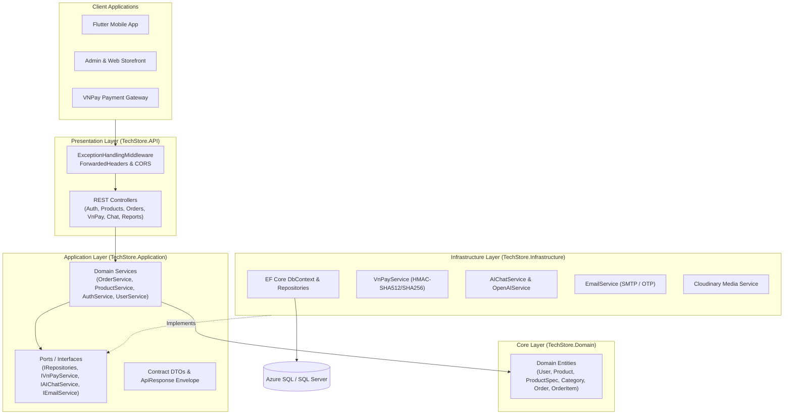

# TechStore — Modern E-Commerce Backend Platform (.NET 10 Clean Architecture)

[](https://dotnet.microsoft.com/)
[](https://learn.microsoft.com/en-us/dotnet/csharp/)
[](https://blog.cleancoder.com/uncle-bob/2012/08/13/the-clean-architecture.html)
[](https://learn.microsoft.com/en-us/ef/core/)
[](https://vnpay.vn/)
[](https://www.microsoft.com/en-us/sql-server)

**TechStore** is a scalable, production-grade E-Commerce RESTful Web API engineered with **.NET 10** and **Clean Architecture**. Designed to power cross-platform mobile (Flutter) and web storefronts, it features cryptographic **VNPay payment gateway verification**, an **AI-assisted product advisor**, **OAuth 2.0 + JWT authentication**, **Cloudinary media storage**, and **transactional SMTP notifications**.

---

## 🏗️ System Architecture

The solution enforces strict **Clean Architecture (4-Layer Separation of Concerns)** where dependencies point inward toward the core domain:



### Layer Breakdown

| Layer | Project | Responsibilities |
| :--- | :--- | :--- |
| **Domain** | `TechStore.Domain` | Pure enterprise entities (`User`, `Product`, `ProductSpec`, `Category`, `Order`, `OrderItem`) with zero external framework dependencies. |
| **Application** | `TechStore.Application` | Core business rules, use-case orchestration, repository/service abstractions, and standardized `ApiResponse<T>` contracts. |
| **Infrastructure** | `TechStore.Infrastructure` | EF Core persistence (`TechStoreDbContext`), SQL Server migrations, VNPay cryptographic signing, SMTP email dispatching, and AI advisor services. |
| **Presentation** | `TechStore.API` | Thin RESTful controllers, JWT Bearer + Google OAuth 2.0 configuration, global exception handling middleware, and OpenAPI/Swagger documentation. |

---

## ⚡ Core Engineering Highlights

### 1. Cryptographic VNPay Payment Gateway Integration
- Generates signed payment URLs with sorted query parameters and **HMAC-SHA512 / SHA256** checksums.
- Validates return callbacks (`/api/vnpay/callback`) to prevent parameter tampering and ensure idempotent order state transitions (`Pending` $\rightarrow$ `Paid` / `Cancelled`).

### 2. Intelligent AI Shopping Advisor (`/api/chat`)
- Context-aware product recommendation engine (`AIChatService` & `IOpenAIService`) capable of natural-language intent detection:
  - Filters catalog inventory in real time by **brand** (*Apple, Dell, Asus*), **category** (*Laptop, Smartphone*), **budget constraints** (*"dưới 15 triệu"*), and **technical specifications**.

### 3. Dual Authentication & OTP Security Pipeline
- **Stateless JWT Bearer Authentication** with role-based claims (`Admin`, `Customer`) and configurable token lifetimes.
- **Google OAuth 2.0** integration for frictionless single sign-on.
- **Transactional OTP Verification** (`/api/otp`) delivered via asynchronous SMTP email templates for account registration and password recovery.

### 4. Standardized API Envelope & Global Exception Handling
- Central `ExceptionHandlingMiddleware` intercepts unhandled exceptions across the pipeline and maps them into a consistent `ApiResponse<T>` JSON structure with appropriate HTTP status codes.
- Configured with `CamelCase` JSON serialization and null-omission optimized for Flutter (`Dio`) and TypeScript clients.

### 5. Cloud Media Pipeline & Analytics Reporting
- Direct multipart image upload streaming to **Cloudinary CDN** (`/api/images/upload`) with automatic public ID management.
- Executive reporting endpoints (`/api/reports`) aggregating revenue metrics, order status breakdowns, and top-selling technology products.

---

## 📡 Key API Endpoints

| Module | Endpoint | Method | Description |
| :--- | :--- | :--- | :--- |
| **Auth & OTP** | `/api/auth/login` | `POST` | Authenticate user and issue signed JWT access token |
| | `/api/auth/register` | `POST` | Register customer account with hashed credentials |
| | `/api/otp/send` | `POST` | Dispatch verification OTP via SMTP email |
| **Catalog** | `/api/products` | `GET / POST` | Query paginated products with specs, brand, and category filters |
| | `/api/categories` | `GET / POST` | Manage technology product categories |
| **Orders** | `/api/orders` | `POST / GET` | Create multi-item orders and track fulfillment lifecycle |
| **Payments** | `/api/vnpay/create-payment-url` | `POST` | Generate signed VNPay checkout URL for an order |
| | `/api/vnpay/callback` | `GET` | Verify VNPay cryptographic signature and update order status |
| **AI Advisor** | `/api/chat/ask` | `POST` | Query the AI shopping assistant for product recommendations |
| **Media & BI** | `/api/images/upload` | `POST` | Upload product imagery to Cloudinary CDN |
| | `/api/reports/summary` | `GET` | Retrieve sales revenue and order analytics |

---

## 🚀 Getting Started

### Prerequisites
- **.NET 10.0 SDK** (or .NET 8.0+)
- **SQL Server** (LocalDB, Docker SQL Server, or Azure SQL Database)

### 1. Clone the Repository
```bash
git clone https://github.com/SnuggieBoy/TechStore.git
cd TechStore
```

### 2. Configure Application Settings
Update `TechStore.API/appsettings.Development.json` (or set environment variables) with your local SQL Server connection string and credentials:

```json
{
  "ConnectionStrings": {
    "DefaultConnection": "Server=localhost,1433;Database=TechStoreDB;User ID=sa;Password=YOUR_LOCAL_DB_PASSWORD;TrustServerCertificate=True;"
  }
}
```

### 3. Apply Database Migrations
```bash
dotnet ef database update --project TechStore.Infrastructure --startup-project TechStore.API
```
*(Alternatively, execute `TechstoreDB.sql` in SQL Server Management Studio to initialize schema and seed catalog data).*

### 4. Run the API
```bash
dotnet run --project TechStore.API
```
Once running, open **`https://localhost:7219/swagger`** (or root `/`) to explore and test all endpoints via the interactive Swagger UI.

---

## 👤 Author

**Lê Trọng Hiếu** — *.NET Backend Engineer*
- GitHub: [@SnuggieBoy](https://github.com/SnuggieBoy)
- Email: Tronghieu848@gmail.com
